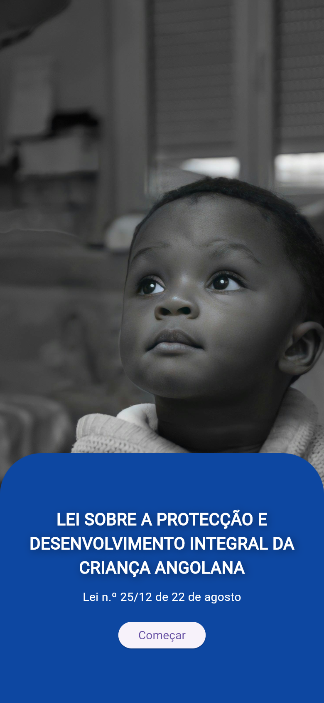
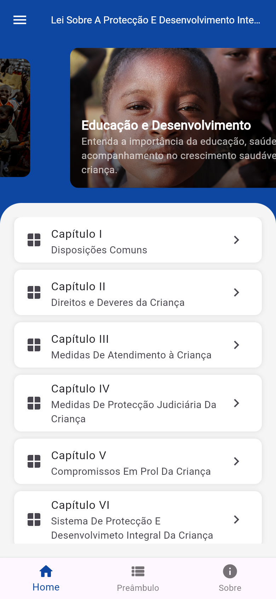
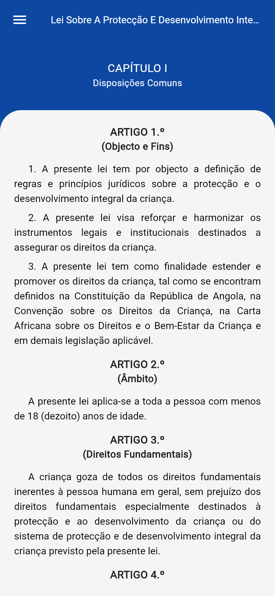
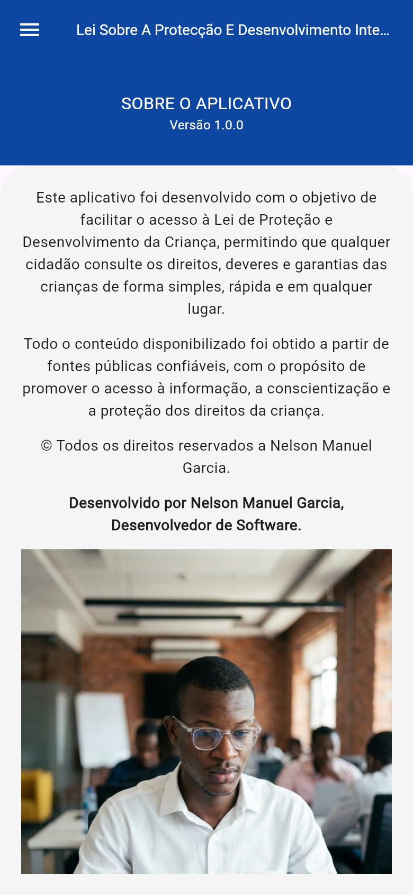

# Lei da Criança — Angola

App móvel em Flutter para consultar a **Lei sobre a Protecção e Desenvolvimento Integral da Criança** (Angola) no telemóvel, sem procurar PDFs nem depender de um computador.

*Flutter app to read Angola's Child Protection and Integral Development Law on your phone. Content in Portuguese.*

> **Estado: em desenvolvimento** (ainda não publicada). A estrutura da app está pronta; os capítulos estão a ser acrescentados um a um. Contribuições são bem-vindas — ver [Contribuir](#contribuir).

<!-- Capturas: colocar os ficheiros em docs/capturas/ e descomentar
<p>
  
  
  
  
</p>
-->

## Porquê
A lei é pública, mas pouca gente a lê: o texto circula em PDF e é difícil de consultar no telemóvel. A app organiza-a por capítulos, secções e artigos para que pais, educadores, estudantes e profissionais encontrem rapidamente os direitos e garantias da criança.

## Funcionalidades
- Ecrã de boas-vindas e página inicial com navegação por capítulos
- Preâmbulo da lei
- Leitura por capítulo, secção e artigo
- Menu lateral (Início, Preâmbulo, Sobre)
- Página "Sobre" com a origem do conteúdo e contactos do autor

## Progresso
- [x] Estrutura da app, navegação e ecrãs base
- [x] Preâmbulo
- [x] Capítulo I — artigos
- [x] Capítulo II — secções
- [ ] Restantes capítulos
- [ ] Pesquisa por palavra-chave
- [ ] Conteúdo em ficheiros JSON (separar o texto da lei da interface)
- [ ] Publicação na Google Play

## Tecnologia
- Flutter / Dart (SDK ^3.10)
- Material Design
- [`url_launcher`](https://pub.dev/packages/url_launcher), [`carousel_slider`](https://pub.dev/packages/carousel_slider)
- Funciona sem internet: o conteúdo vem dentro da app

## Estrutura
```
lib/
├── main.dart                     # rotas da app
└── app/pages/
    ├── welcome.dart              # boas-vindas
    ├── home.dart                 # início e navegação
    ├── preambulo.dart
    ├── sobre.dart
    ├── capitulo_01/artigos/      # Capítulo I
    └── capitulo_02/seccoes/      # Capítulo II
```

## Como correr
```bash
git clone https://github.com/nelsongarcia01/mobile-lei-de-proteccao-da-crianca-v1.git
cd mobile-lei-de-proteccao-da-crianca-v1
flutter pub get
flutter run
```

## Contribuir
Ajuda na transcrição dos capítulos em falta, correcções ao texto e melhorias de interface são bem-vindas.
1. Faça *fork* do repositório e crie um ramo (`git checkout -b capitulo-03`).
2. Faça as alterações e confirme que a app corre (`flutter analyze` e `flutter run`).
3. Abra um *pull request* a explicar o que mudou e porquê.

Encontrou um erro no texto de um artigo? Abra uma *issue* com o número do artigo e o texto correcto.

## Conteúdo e imagens
- O texto da lei é público e foi transcrito de fontes oficiais. A app tem fins informativos e não substitui a publicação oficial em Diário da República nem aconselhamento jurídico.
- Imagens: [Pixabay](https://pixabay.com), ao abrigo da [Licença de Conteúdo Pixabay](https://pixabay.com/service/license-summary/).

## Licença
Código distribuído sob a licença [MIT](LICENSE).

## Autor
**Nelson Manuel Garcia** — Full Stack Developer (Angular & Node.js) · Fundador da [Negasoft](https://github.com/negasoftangola)
[LinkedIn](https://www.linkedin.com/in/nelsonmanuelgarcia) · [GitHub](https://github.com/nelsongarcia01)
